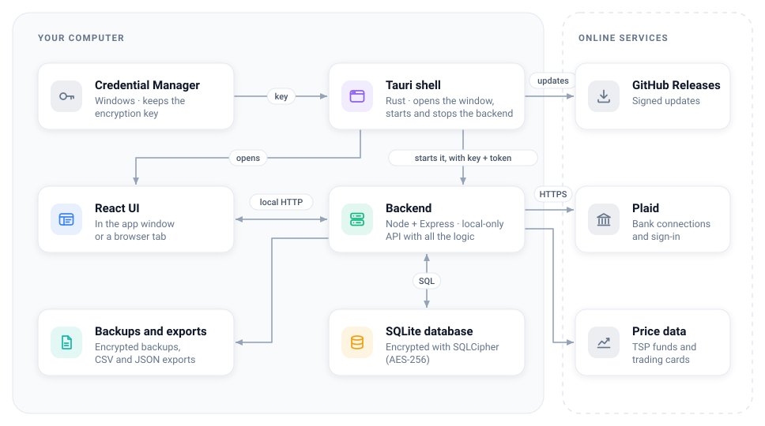

# Personal Finance

A personal finance app for Windows that keeps everything on your own computer. Your data is
encrypted on disk and never goes to anyone else's server.

- **Accounts and transactions** from your banks (through Plaid), CSV imports, or typed in by hand
- **Budgets, bills and a calendar** of what is coming up
- **Goals, debts, investments** (including the TSP) and net worth over time
- **Reports and insights**: where the money goes, subscriptions, taxes, refunds and transfers

## Install

1. From the [latest release](https://github.com/ZeBlast/personal_finance/releases/latest),
   download `Personal Finance_x.y.z_x64-setup.exe` under **Assets**.
2. Run it. It installs for your Windows user only, so no administrator password is needed.

If Windows shows **"Windows protected your PC"**, choose **More info**, then **Run anyway** (the app
is not code-signed yet). Requires Windows 10 or 11, 64-bit.

## Getting started

The welcome page offers three ways in: **connect your banks**, **import or type accounts in**, or
**look around** with made-up sample banks. Its checklist walks you through the rest.

**Save your recovery key.** The encryption key lives in your Windows account, so the app opens
without a password. If you reinstall Windows or change computers, only the recovery key can open
your data and backups. Find it in **Settings > Data & backups > Show recovery key**.

**To connect banks**, you need a free [Plaid](https://dashboard.plaid.com/signup) account of your
own:

1. In Plaid's dashboard, request **Production** access for personal use (approval can take a few
   days).
2. Under **Developers > Keys**, copy your **client ID** and **Production secret**.
3. In the app, open **Settings > My real banks**, paste both and save.
4. Open **Accounts > Connect an account**.

## Good to know

- **Updates:** **Settings > Updates > Check for updates** installs a signed new version and
  restarts. Your data is backed up before the new version first runs.
- **Browser tab:** while the app is open, **Settings** can open the same app in your browser.
- **Backups and exports:** **Settings > Data & backups**.
- **Uninstall** from Windows **Settings > Apps**. Your data folder is kept unless you delete it.

| What                  | Where                                                     |
| --------------------- | --------------------------------------------------------- |
| Your data (encrypted) | `%APPDATA%\com.personalfinance.app\personal-finance.db`   |
| Backups (encrypted)   | `%APPDATA%\com.personalfinance.app\backups`               |
| Log                   | `%LOCALAPPDATA%\com.personalfinance.app\logs\backend.log` |

## Architecture

The app has no server of its own. Everything runs on your computer as three parts: a small native
shell, a local backend, and the user interface.

<picture>
  <source media="(prefers-color-scheme: dark)" srcset="docs/images/architecture-dark.svg">
  
</picture>

Without internet the app still works and shows your last synced data.

**How it fits together**

- **Tauri shell** ([`src-tauri/`](src-tauri)): a thin Rust program. On launch it reads the
  encryption key from the Windows Credential Manager, picks a free local port, makes a random
  token for this launch, starts the backend with them, and opens the window. It stops the backend when you
  quit.
- **Backend** ([`backend/`](backend)): Node, Express and Drizzle, bundled into a single
  `backend.exe` that the installer ships beside the app. It listens on `127.0.0.1` only and answers
  only requests that carry the launch token and come from the app's own window or tab. It handles
  syncing, imports, rules, budgets, forecasts and reports.
- **UI** ([`frontend/`](frontend)): React, TypeScript, Vite and Tailwind. The same build runs in
  the app window and, served by the backend, in a browser tab.
- **Database** ([`drizzle/`](drizzle)): one SQLite file, fully encrypted (AES-256 through
  SQLCipher). Plaid access tokens and your Plaid secret are encrypted again on their own
  (AES-256-GCM). Migrations run at startup, and the data is backed up before an update first runs.

**Bank sync.** Plaid Link (Plaid's own sign-in window) connects a bank. The backend then talks to
Plaid's API directly and pulls new transactions on launch, on **Sync now**, and optionally on a
timer. Each sync picks up where the last one stopped, and your own edits are stored apart from the
bank's data, so a sync never overwrites them.

## Building it yourself

See [DEVELOPING.md](DEVELOPING.md) for building and changing the app, and
[RELEASING.md](RELEASING.md) for publishing a version.
